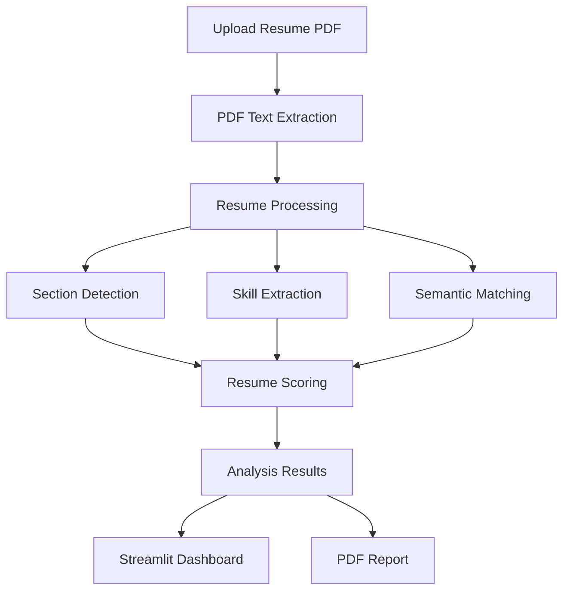

# 🤖 AI Resume Analyzer

An AI-powered Resume Analyzer built using Python that evaluates resumes against job descriptions and provides insights to help improve resume quality and job relevance.

## 🚀 Features

- 📄 **PDF Resume Extraction** – Extract text from PDF resumes using `pdfplumber`.
- 🧠 **AI-Based Semantic Matching** – Uses Sentence Transformers to compare resume content with job descriptions.
- 🛠️ **Skill Extraction** – Identifies relevant technical skills from resumes.
- 📊 **Resume Scoring** – Evaluates resumes using multiple scoring criteria.
- 📈 **Detailed Analysis** – Provides insights into skills, impact, structure, and job relevance.
- 📑 **PDF Report Generation** – Generates downloadable analysis reports.
- 🌐 **Interactive Dashboard** – User-friendly interface built with Streamlit.
- ⚡ **FastAPI Backend** – Provides backend functionality for resume analysis.

## 🛠️ Tech Stack

| Technology | Purpose |
|---|---|
| Python | Core programming language |
| FastAPI | Backend API |
| Streamlit | Interactive frontend |
| pdfplumber | PDF text extraction |
| Sentence Transformers | Semantic similarity |
| OpenCV | Computer vision-related processing |
| ReportLab | PDF report generation |

## 🏗️ Architecture



## 📊 Resume Scoring

The analyzer evaluates resumes using the following weighted criteria:

| Criteria | Weight |
|---|---:|
| Skill Matching | 40% |
| Semantic Similarity | 25% |
| Impact Analysis | 20% |
| Resume Structure | 15% |

The final score is calculated using these weighted components.

## 💻 Installation

### 1. Clone the repository

```bash
git clone https://github.com/Alanbinoy22/AI-RESUME--ANALYZER.git
```

### 2. Navigate to the project

```bash
cd AI-RESUME--ANALYZER
```

### 3. Create a virtual environment

```bash
python -m venv .venv
```

### 4. Activate the virtual environment

**Windows:**

```bash
.venv\Scripts\activate
```

**Linux/macOS:**

```bash
source .venv/bin/activate
```

### 5. Install dependencies

```bash
pip install -r requirements.txt
```

## ▶️ Usage

Run the application using the appropriate commands for your project setup.

### Start the FastAPI backend

```bash
uvicorn app.main:app --reload
```

### Start the Streamlit frontend

```bash
streamlit run ui/app.py
```

> Note: Adjust the entry-point paths if your project uses different filenames.

## 📂 Project Structure

```text
AI-RESUME--ANALYZER/
│
├── app/                 # Backend application
├── data/                # Application data
├── ui/                  # Streamlit frontend
├── tests/                # Testing scripts
├── requirements.txt        # Python dependencies
├── README.md              # Project documentation
└── .gitignore            # Git ignored files
```

## 🎯 Project Objective

The objective of this project is to develop an intelligent resume analysis system that helps job seekers understand how well their resumes match specific job descriptions.

The system combines resume parsing, skill extraction, semantic similarity, and heuristic scoring to provide useful feedback.

## 🔮 Future Improvements

- Improve skill extraction using NLP techniques.
- Support additional resume formats.
- Enhance scoring accuracy.
- Add more detailed resume improvement recommendations.
- Expand testing and validation.
- Improve dashboard visualization.

## 👨‍💻 Developed By

**Alan Binoy**

B.Tech Computer Science and Engineering

College of Engineering Chengannur

GitHub: [Alanbinoy22](https://github.com/Alanbinoy22)

---

⭐ If you find this project interesting, consider giving it a star!
