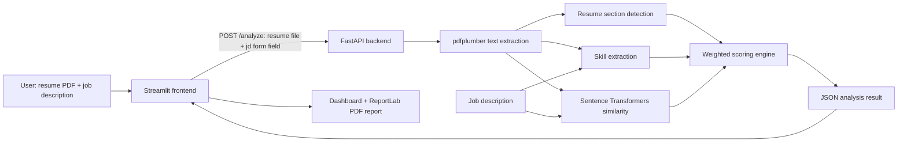

# AI Resume Analyzer

A Python application that compares a resume PDF with a job description. It extracts resume text, identifies selected skills and section headings, calculates a heuristic match estimate, and presents the results in a Streamlit dashboard.

This project is intended as a portfolio and learning project. Its score is not an official ATS score and does not predict hiring outcomes.

## Features

- Upload a text-based resume PDF and extract its text with `pdfplumber`.
- Paste a job description and compare detected skills.
- Calculate semantic similarity with the `all-MiniLM-L6-v2` Sentence Transformers model.
- Score resume impact and the presence of Education, Experience, Projects, and Skills sections.
- View the overall score, its components, matched and missing skills, and missing sections in Streamlit.
- Generate and download a PDF analysis report with ReportLab.

## Technology stack

| Technology | Use |
| --- | --- |
| Python | Application logic |
| FastAPI | Resume analysis API |
| Streamlit | User interface and dashboard |
| pdfplumber | PDF text extraction |
| Sentence Transformers | Semantic similarity using `all-MiniLM-L6-v2` |
| ReportLab | Downloadable PDF reports; install separately (see setup) |
| Requests | Streamlit-to-FastAPI HTTP request |

## Architecture



## Project structure

```text
.
├── app/
│   ├── api.py                  # FastAPI endpoint and request processing
│   ├── parser.py               # PDF text extraction
│   ├── sections.py             # Resume section detection
│   ├── skills.py               # Predefined skill and alias matching
│   ├── matching.py             # Skill helper and semantic similarity
│   ├── scoring.py              # Match score and response fields
│   ├── llm.py                  # Present but currently unused
│   └── __init__.py
├── data/
│   └── skills.json             # Predefined technical skill names
├── ui/
│   └── streamlit_app.py        # Streamlit interface and PDF report generation
├── test_matching.py            # Manual skill comparison script
├── test_parser.py              # Manual PDF text extraction script
├── test_scoring.py             # Manual end-to-end scoring script
├── test_sections.py            # Manual section detection script
├── test_semantic.py            # Manual semantic similarity script
├── test_skills.py              # Skill list inspection script
├── test_skill_extraction.py    # Manual resume skill extraction script
├── check_setup.py              # Dependency import check
├── resume.pdf                  # Local sample input used by scripts
└── requirements.txt            # Main Python dependencies
```

## Installation

Prerequisites: Python 3.10 or later is recommended. Sentence Transformers may download its model the first time the backend starts.

```bash
git clone <your-repository-url>
cd <repository-folder>
python -m venv .venv
```

Activate the environment, then install the project dependencies. ReportLab is not currently included in `requirements.txt`, so install it separately to enable PDF report generation.

**Windows PowerShell**

```powershell
.venv\Scripts\Activate.ps1
python -m pip install -r requirements.txt
python -m pip install reportlab
```

**macOS / Linux**

```bash
source .venv/bin/activate
python -m pip install -r requirements.txt
python -m pip install reportlab
```

## Run locally

Open two terminals in the project folder, with the virtual environment activated in each.

Terminal 1 — API:

```bash
uvicorn app.api:app --reload
```

Terminal 2 — user interface:

```bash
streamlit run ui/streamlit_app.py
```

Open the Streamlit URL shown in the terminal (normally `http://localhost:8501`). The UI sends requests to `http://127.0.0.1:8000/analyze`.

## Usage

1. Upload a text-based PDF resume.
2. Paste the target job description. The example button is only starter text; replace it with the real description.
3. Select **Analyze resume**.
4. Review the estimated overall match, score components, detected skills, and resume section checks.
5. Select **Prepare PDF report**, then download the generated report.

Scanned PDFs may not work because the current parser extracts embedded text and does not run OCR.

## Scoring methodology

The score is calculated from four normalized components:

```text
total = 100 * (
    0.40 * skill_match
  + 0.25 * semantic_similarity
  + 0.20 * impact
  + 0.15 * structure
)
```

- **Skill match (40%)**: job-description skills found in the resume divided by all detected job-description skills. If no known job skills are found, the denominator is set to one.
- **Semantic similarity (25%)**: cosine similarity between Sentence Transformer embeddings for the resume and job description.
- **Impact (20%)**: share of resume lines longer than four words that contain a digit or begin with one of a fixed set of action verbs.
- **Structure (15%)**: share of four expected sections (Education, Experience, Projects, Skills) that contain text.

This is a heuristic matching estimate, not an official ATS score. The semantic similarity model is not a recruiter and does not assess candidate quality.


## Current limitations

- Skills are detected by case-insensitive matching against a small predefined list and aliases; context and equivalent terms may be missed.
- PDF text extraction depends on embedded selectable text. The backend returns an error when fewer than 200 characters are extracted; there is no OCR.
- Section detection recognizes a limited set of headings and checks only four sections for the structure score.
- The impact score uses simple word and digit rules and does not understand achievement quality.
- Semantic similarity measures text similarity, not whether a candidate meets all role requirements.
- There is no official ATS integration or validation, and the score is not a hiring prediction.
- `app/llm.py` is present but is not used in the analysis flow. Suggestions shown in the UI are rule-based.
- The scripts named `test_*.py` print outputs and do not currently provide automated assertions.

## Future scope

Potential enhancements, not currently implemented: OCR for scanned resumes, broader contextual skill extraction, personalized LLM feedback, multiple job comparisons, job recommendations, resume version history, clearer scoring explanations, cloud deployment, authentication, analytics, multilingual support, a larger skill catalog, and job portal integrations.

## Contributing

Issues and pull requests are welcome. Please describe the change and its impact, keep analysis results grounded in real backend output, and avoid committing personal resumes or other private documents.

## License

No license file is currently included. Choose a license and add its full text in a `LICENSE` file before describing this repository as open source.
