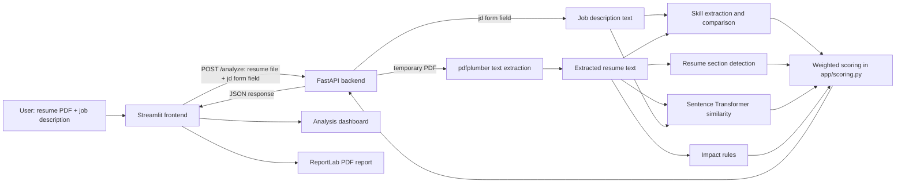

# AI Resume Analyzer


AI Resume Analyzer compares a resume PDF with a job description and highlights detected skill overlap, missing skills, and common resume sections. It combines straightforward text checks with semantic similarity to help job seekers review how their resume relates to a specific role.

This is a personal portfolio project. Its score is a heuristic estimate, not an official ATS score or a prediction of hiring outcomes.

## Features

- Upload a resume PDF and extract selectable text with `pdfplumber`.
- Detect common resume sections such as Education, Experience, Projects, and Skills.
- Extract skills from the resume and job description using a predefined list and aliases.
- Compare detected skills and show matched and missing terms.
- Calculate semantic similarity using Sentence Transformers and `all-MiniLM-L6-v2`.
- Calculate an overall score from skill match, semantic similarity, impact, and structure.
- View the results in a Streamlit dashboard.
- Generate and download a PDF analysis report using ReportLab.

## Screenshots

**Screenshots are not currently available in the repository.** To complete this section, capture genuine screenshots of the running application showing:

1. The input page with a PDF selected and a job description entered.
2. The results dashboard with the overall score and score breakdown.
3. Matched and missing skills, resume structure, and suggestions.
4. A page of the generated PDF report.

Use real application output and avoid including personal resume details.

## Technology stack

| Technology | Purpose |
| --- | --- |
| Python | Application and analysis logic |
| FastAPI | Receives the resume and job description and returns analysis results |
| Streamlit | Provides the interactive input page and results dashboard |
| pdfplumber | Extracts text from PDF pages |
| Sentence Transformers | Creates embeddings for semantic similarity |
| ReportLab | Generates the downloadable PDF report |
| Requests | Sends the frontend request to FastAPI |
| Uvicorn | Runs the FastAPI application locally |
| python-multipart | Lets FastAPI receive the uploaded PDF and form field |

## Architecture



FastAPI accepts the PDF as `resume` and the job description as the `jd` form field. It extracts resume text, detects sections, and calls the scoring module. The scoring module performs skill comparisons, uses the semantic similarity helper, calculates impact and structure, then returns the results as JSON. Streamlit displays that response and can use it to generate the PDF report.

## Project structure

```text
AI-RESUME--ANALYZER/
├── app/
│   ├── __init__.py
│   ├── api.py                  # FastAPI endpoint and request processing
│   ├── llm.py                  # Present but not used in the current analysis flow
│   ├── matching.py             # Skill helper and semantic similarity function
│   ├── parser.py               # PDF text extraction
│   ├── scoring.py              # Score calculation and result fields
│   ├── sections.py             # Resume section detection
│   └── skills.py               # Skill and alias matching
├── data/
│   └── skills.json             # Predefined skill catalog
├── docs/
│   ├── AI_Resume_Analyzer_Project_Report.md
│   └── AI_Resume_Analyzer_Project_Report.pdf
├── ui/
│   └── streamlit_app.py        # Frontend, dashboard, and PDF report generation
├── check_setup.py              # Checks imports for selected dependencies
├── requirements.txt            # Python dependencies
├── README.md                   # GitHub project documentation
├── test_matching.py            # Manual skill matching script
├── test_parser.py              # Manual PDF extraction script
├── test_scoring.py             # Manual end-to-end scoring script
├── test_sections.py            # Manual section detection script
├── test_semantic.py            # Manual semantic similarity script
├── test_skill_extraction.py    # Manual skill extraction script
└── test_skills.py              # Skill catalog inspection script
```

Local virtual environments and temporary files are omitted from this tree.

## Installation

### Prerequisites

- Python 3.10 or later is recommended.
- Internet access may be needed the first time Sentence Transformers downloads `all-MiniLM-L6-v2`.

Clone the repository and create a virtual environment:

```bash
git clone https://github.com/Alanbinoy22/AI-RESUME--ANALYZER.git
cd AI-RESUME--ANALYZER
python -m venv .venv
```

Install the dependencies:

**Windows PowerShell**

```powershell
.venv\Scripts\Activate.ps1
python -m pip install -r requirements.txt
```

**Linux / macOS**

```bash
source .venv/bin/activate
python -m pip install -r requirements.txt
```

`reportlab` is required for the PDF report and is included in `requirements.txt`.

## Run the application

Start the backend in one terminal:

```bash
uvicorn app.api:app --reload
```

Start the Streamlit interface in a second terminal:

```bash
streamlit run ui/streamlit_app.py
```

Open the Streamlit URL printed in the terminal, normally `http://localhost:8501`. The frontend sends analysis requests to `http://127.0.0.1:8000/analyze`.

## Usage

1. Upload a text-based resume PDF.
2. Enter the job description you want to compare against. The example text in the UI is only a starting point; replace it with the actual description.
3. Select **Analyze resume** and wait for the backend response.
4. Review the overall score and the Skill Match, Semantic Similarity, Impact, and Structure components.
5. Review matched and missing skills, and check which common resume sections were detected.
6. Select **Prepare PDF report**, then **Download Analysis Report (PDF)** to download the report for the current analysis.

The report contains the analysis results and suggestions, not the uploaded resume.

## Scoring methodology

The backend uses this weighted formula in `app/scoring.py`:

```text
total = 100 * (
    0.40 * skill_match
  + 0.25 * semantic_similarity
  + 0.20 * impact
  + 0.15 * structure
)
```

| Component | Weight | How it is calculated |
| --- | ---: | --- |
| **Skill Match** | 40% | Detected job-description skills also found in the resume, divided by the number of detected job-description skills. The denominator is at least one. |
| **Semantic Similarity** | 25% | Cosine similarity between Sentence Transformer embeddings of the resume text and job description. |
| **Impact** | 20% | Share of resume lines longer than four words that contain a digit or start with a configured action verb, such as `built`, `developed`, or `improved`. |
| **Structure** | 15% | Share of the four core sections—Education, Experience, Projects, and Skills—that have detected content. |

The application returns a project-generated heuristic score. It is not an official ATS score, does not guarantee an ATS result, and should not be treated as a hiring decision.

## Limitations

- **Predefined skills:** the application checks a small skill list in `data/skills.json` and a few aliases. New terms and equivalent wording can be missed.
- **Keyword-based extraction:** finding a skill name does not prove the candidate has that skill or understand it at a particular level.
- **PDF text extraction:** scanned or image-only PDFs may not produce readable text. OCR is not implemented; the API returns an error when it extracts fewer than 200 characters.
- **Section detection:** only configured headings and simple line rules are recognized. Structure scoring considers four sections.
- **Heuristic scoring:** impact and section scores are based on simple rules rather than a full evaluation of writing quality or qualifications.
- **Semantic similarity:** text similarity is not a factual check that the resume meets all job requirements.
- **No ATS validation:** the project does not integrate with or validate scores against an applicant tracking system.
- **Suggestions:** current improvement suggestions are rule-based, not personalized LLM feedback. `app/llm.py` is not used in the analysis path.
- **Manual test scripts:** the `test_*.py` scripts print examples and do not contain automated assertion-based tests.

## Future scope

These are potential enhancements, not current features:

- OCR for scanned PDFs.
- A larger skill catalog and context-aware skill extraction.
- LLM-based personalized feedback with safeguards against fabricated claims.
- Comparison against multiple job descriptions and job recommendations.
- Resume version management and additional analytics.
- More detailed scoring explanations and systematic evaluation.
- Cloud deployment, user authentication, and multilingual support.
- Job portal integrations.

## Contributing

Issues and pull requests are welcome. Please explain the change and its impact, keep feature claims aligned with the implementation, and do not commit personal resumes or other private documents.

## License

No license file is currently included. Add a `LICENSE` file with the selected license terms before presenting the repository as open source.
