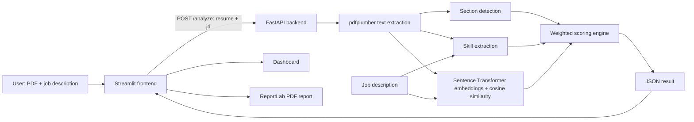

# AI Resume Analyzer — Project Report

## 1. Project Overview

**AI Resume Analyzer** is a Python portfolio application that compares a candidate's resume with a supplied job description. The user uploads a PDF and pastes the role description in a Streamlit interface. A FastAPI backend extracts and analyzes the resume text and returns a match estimate with a score breakdown, matched and missing skills, and missing resume sections.

The project helps job seekers review how the current resume text aligns with one job description and identify possible areas to inspect. It is also a demonstration of connecting a Python web interface to an API and combining text processing with a pretrained semantic similarity model.

**Target users:** job seekers, students exploring resume tailoring, and developers/recruiters reviewing the project as a software portfolio example.

**Key implemented features:** PDF upload and text extraction, section detection, predefined skill matching, semantic similarity, weighted scoring, result dashboard, and downloadable PDF analysis report.

## 2. Introduction

A resume is usually reviewed in the context of a particular role. Comparing it with that role's job description can help a person notice relevant skills that are already present, skills that the program did not detect, and common resume sections that may need clearer headings.

This application automates a small set of those checks. It does not decide whether a candidate is qualified. Its output depends on extracted PDF text, a finite skill catalog, simple section and impact rules, and a general text-embedding model. The score should be treated as a project-generated estimate to support review, not as an official ATS result.

## 3. Implemented Features

- **Resume PDF upload:** Streamlit accepts PDF files and sends the uploaded bytes to the backend.
- **Resume text extraction:** `pdfplumber` reads text from each page. The API rejects resumes from which fewer than 200 characters were extracted.
- **Resume section detection:** recognized headings include variants for Education, Experience, Projects, Skills, and Certifications. Structure scoring uses Education, Experience, Projects, and Skills.
- **Skill extraction:** a predefined JSON skill list and aliases are matched case-insensitively with word-boundary checks.
- **Job description analysis:** the job description is submitted as the `jd` form field and searched using the same skill catalog.
- **Skill comparison:** the API reports the intersection of resume and job skills as matched and job skills absent from resume text as missing.
- **Semantic similarity:** Sentence Transformers encodes the full resume and description with `all-MiniLM-L6-v2`; cosine similarity is used as one score component.
- **Resume match score:** skill match, semantic similarity, impact, and structure are combined using fixed weights.
- **Dashboard:** Streamlit displays the total estimate, component scores, matched and missing skills, and expected section status.
- **Improvement suggestions:** current UI suggestions are rule-based and draw on missing skills, the impact component, and missing sections. They do not fabricate achievements.
- **PDF report:** the UI can build a ReportLab PDF from the current analysis response. It contains scores, skill lists, structure results, and suggestions; it excludes the uploaded resume.

## 4. Technology Stack

| Technology | Role in this project |
| --- | --- |
| Python | Main programming language for the backend, analysis, and interface. |
| FastAPI | Defines the `POST /analyze` endpoint and processes multipart form input. |
| Streamlit | Provides the upload form, job-description input, dashboard, and report controls. |
| pdfplumber | Extracts selectable text from uploaded PDF pages. |
| Sentence Transformers | Produces text embeddings using `all-MiniLM-L6-v2` for semantic similarity. |
| ReportLab | Builds the downloadable PDF report. It is used by the UI but is not currently listed in `requirements.txt`; install it separately. |
| Requests | Sends the Streamlit form data and PDF to FastAPI over HTTP. |
| python-multipart | Supports uploaded files and form fields in FastAPI. |

Scikit-learn appears as a skill name in `data/skills.json` but is not used as a project dependency or in the current analysis implementation.

## 5. System Architecture



The user enters data in Streamlit. The UI posts the PDF under the `resume` field and the job description under `jd` to `http://127.0.0.1:8000/analyze`. FastAPI temporarily stores the upload, extracts text, removes the temporary file, detects sections, and calls the scoring engine. The JSON response is saved and displayed by Streamlit. PDF report generation happens in the frontend from that response.

## 6. Project Workflow

1. The user uploads a PDF resume in Streamlit.
2. The user enters a job description.
3. On **Analyze resume**, Streamlit sends a multipart `POST /analyze` request with `resume` and `jd` fields.
4. FastAPI copies the uploaded file to a temporary PDF, then calls `pdfplumber` to collect text from pages.
5. FastAPI deletes the temporary file, including when extraction raises an error.
6. If extracted text is shorter than 200 characters, the API responds with an error message. This can affect scanned PDFs because OCR is not implemented.
7. `split_sections` assigns text lines to recognized headings.
8. The scoring module extracts known skills from resume and job-description text and determines matched and missing skills.
9. The semantic similarity helper embeds both full texts and computes cosine similarity.
10. The backend evaluates impact and the presence of the four core sections, applies the weighted formula, and returns JSON.
11. Streamlit displays the current result in the dashboard.
12. If requested, the frontend builds a PDF report from the same result and offers it for download.

## 7. Resume Scoring Methodology

The implemented formula in `app/scoring.py` is:

```python
total = 100 * (
    0.40 * skill_match
    + 0.25 * semantic
    + 0.20 * impact
    + 0.15 * structure
)
```

All components are normalized from 0 to 1 before the weighted sum.

| Component | Weight | Current calculation |
| --- | ---: | --- |
| Skill match | 40% | Number of skills found in both texts divided by the number of detected job-description skills. The denominator is at least one. |
| Semantic similarity | 25% | Cosine similarity of the Sentence Transformer embeddings for the complete resume and job-description text. |
| Impact | 20% | Fraction of resume lines longer than four words that contain a digit or begin with one of a fixed set of action verbs, such as `built`, `developed`, or `improved`. |
| Structure | 15% | Fraction of Education, Experience, Projects, and Skills sections that have non-empty content after section splitting. |

The backend rounds the total to one decimal place and component values to two decimals. The UI converts component values to percentages for display. This is a heuristic estimate, not an official ATS score or hiring prediction.

## 8. Project Structure

```text
.
├── app/
│   ├── __init__.py
│   ├── api.py
│   ├── llm.py
│   ├── matching.py
│   ├── parser.py
│   ├── scoring.py
│   ├── sections.py
│   └── skills.py
├── data/
│   └── skills.json
├── docs/
│   ├── AI_Resume_Analyzer_Project_Report.md
│   └── AI_Resume_Analyzer_Project_Report.pdf
├── ui/
│   └── streamlit_app.py
├── check_setup.py
├── requirements.txt
├── resume.pdf
├── test_matching.py
├── test_parser.py
├── test_scoring.py
├── test_sections.py
├── test_semantic.py
├── test_skill_extraction.py
└── test_skills.py
```

The `tests/` and `eval/` directories exist in the workspace but contain no project files. The `docs/` directory and report files in this tree are created by this documentation task. `.venv/` is a local environment and is intentionally omitted. `resume.pdf` is a local sample input; check that it is appropriate to publish before committing it.

| File | Purpose |
| --- | --- |
| `app/api.py` | FastAPI endpoint, temporary upload handling, extraction orchestration, and result response. |
| `app/parser.py` | PDF page text extraction. |
| `app/sections.py` | Splits extracted lines into recognized resume sections. |
| `app/skills.py` | Reads the skill list and finds skills and aliases in text. |
| `app/matching.py` | Provides a standalone skill-match helper and the semantic similarity function used by scoring. The main `analyze` function computes the skill sets directly. |
| `app/scoring.py` | Impact calculation, weighted score, and output fields. |
| `app/llm.py` | Present in the source tree but not used by the current analysis path. |
| `data/skills.json` | Predefined technical skill names. |
| `ui/streamlit_app.py` | Streamlit interface, backend request, dashboard, suggestions, and ReportLab report generation. |
| `requirements.txt` | Main Python packages; ReportLab is not listed. |
| `test_*.py` | Manual scripts that invoke functions and print their outputs. |
| `check_setup.py` | Checks that selected installed packages can be imported. |

## 9. Implementation Details

### Resume parser

`app/parser.py` opens the PDF with `pdfplumber`, extracts available text page by page, and joins it into one string. Pages without extractable text are skipped.

```python
with pdfplumber.open(path) as pdf:
    pages = [page.extract_text() for page in pdf.pages if page.extract_text()]
return "\n".join(pages)
```

### Section detector

`app/sections.py` scans each line and checks whether a short line begins with a known heading. It stores subsequent lines under the active section until another recognized heading appears. Detection is heading-based, not a deep understanding of resume layout.

### Skill extractor

`app/skills.py` reads `data/skills.json`, lowercases input text, and uses regular expressions to find terms with alphanumeric boundaries. Aliases currently include `js` → `javascript`, `ml` → `machine learning`, and `k8s` → `kubernetes`, among others.

### Semantic similarity

`app/matching.py` loads `SentenceTransformer("all-MiniLM-L6-v2")` and encodes the full resume and job description. The cosine similarity is converted to a percentage by the helper; `app/scoring.py` converts it back to a 0–1 component for the weighted total.

### Scoring engine

`app/scoring.py` calculates the four weighted components and returns `total`, `breakdown`, `matched_skills`, `missing_skills`, and `missing_sections`. The standalone `match_skills` helper in `app/matching.py` is not called by `analyze`; the score module performs its own skill set comparison.

### API

The backend exposes `POST /analyze`, with an uploaded file named `resume` and form text named `jd`. It returns JSON. It does not save the analysis or resume as a permanent record.

### Streamlit UI and PDF report

`ui/streamlit_app.py` validates that both inputs are present, submits the request with `requests.post`, and handles connection, timeout, and HTTP errors. It displays the score dashboard and rule-based suggestions. The report builder uses ReportLab Platypus to create an A4 PDF in memory with score tables, skill lists, structure status, suggestions, and page numbers.

## 10. Installation and Setup

### Prerequisites

- Python 3.10 or later recommended.
- Internet access may be needed the first time Sentence Transformers downloads `all-MiniLM-L6-v2`.
- ReportLab is required for the PDF download but is not currently present in `requirements.txt`.

```bash
git clone <your-repository-url>
cd <repository-folder>
python -m venv .venv
```

Activate the environment and install dependencies:

**Windows PowerShell**

```powershell
.venv\Scripts\Activate.ps1
python -m pip install -r requirements.txt
python -m pip install reportlab
```

**macOS / Linux**

```bash
source .venv/bin/activate
python -m pip install -r requirements.txt
python -m pip install reportlab
```

Start the backend and frontend in separate terminals:

```bash
uvicorn app.api:app --reload
```

```bash
streamlit run ui/streamlit_app.py
```

Open the local URL printed by Streamlit, usually `http://localhost:8501`. FastAPI listens on `http://127.0.0.1:8000` for the UI's analysis request.

Example job description for trying the interface:

```text
We are looking for a Python developer to build reliable web applications.
Required skills: Python, SQL, Git, FastAPI, and Docker.
The candidate should have experience delivering software projects.
```

This is example input, not an example result. Replace it with a real job description when analyzing a resume.

## 11. Usage Guide

1. Start the FastAPI backend and Streamlit UI using the commands above.
2. Upload a text-based resume PDF in the **Resume PDF** area.
3. Paste a job description in the input area. The example control provides starter text only.
4. Choose **Analyze resume** and wait for the API response.
5. Review the overall score and four score components. Higher numbers indicate stronger results according to these project rules only.
6. Review matched skills. These were detected in both texts using the known skill list.
7. Review missing skills. They were not detected in resume text; this does not prove the candidate lacks them.
8. Review which of the four structure headings the backend marked as missing.
9. Choose **Prepare PDF report**, then **Download Analysis Report (PDF)** to save the analysis summary.

## 12. Testing

The current project contains scripts named `test_*.py`, but they are not conventional automated tests: they run code at import/execution time, print values, and contain no assertion-based test functions. Their purposes are:

| Script | What it exercises |
| --- | --- |
| `test_parser.py` | Extracts and prints text from the local `resume.pdf`. |
| `test_sections.py` | Extracts the sample resume text, splits sections, and prints the result. |
| `test_skill_extraction.py` | Prints skills detected in the sample resume. |
| `test_skills.py` | Reads the JSON skills list and prints its size and first entries. |
| `test_matching.py` | Runs the standalone skill comparison helper on example strings. |
| `test_semantic.py` | Calculates semantic similarity for the sample resume and a fixed description. |
| `test_scoring.py` | Runs an end-to-end analysis on the sample resume and a fixed job description, then prints scores and lists. |
| `check_setup.py` | Imports selected libraries to check whether they are available. |

No automated test result or performance benchmark is claimed in this report. Running the scripts depends on having the local sample PDF and required model/dependencies available.

## 13. Results

The application returns an overall estimate out of 100, four normalized component values, matched skills, missing skills, and a list of missing core sections. The dashboard converts component values to percentages. The downloadable PDF includes these same results plus UI-generated rule-based suggestions.

No fixed result values are included here because outputs depend on the resume and job description provided at runtime. No project screenshots were found in the workspace, so none are represented as real application captures in this report.

## 14. Limitations

- **Predefined skill catalog:** only terms present in `data/skills.json` and the aliases can be detected.
- **Keyword-based skill extraction:** matching does not understand context, proficiency, or related but differently worded skills. A mention does not prove expertise.
- **PDF extraction:** scanned/image-only PDFs may produce little or no text. There is no OCR, and the API checks for at least 200 extracted characters.
- **Section detection:** a limited set of headings and line rules is used; unusual formatting or heading names may be missed.
- **Heuristic impact and structure scores:** simple line, action-word, digit, and section checks do not assess writing quality or career context.
- **Semantic similarity:** embedding similarity is a broad text comparison, not a factual qualification check.
- **No official ATS validation:** the project does not connect to applicant tracking systems and cannot guarantee an ATS score or interview.
- **Suggestions:** currently rule-based and limited to available result fields; the application does not use `app/llm.py` to create personalized advice.
- **Manual scripts:** the existing `test_*.py` files do not assert expected behavior automatically.
- **Dependency setup:** ReportLab is imported only when creating the report and must be installed separately because it is absent from `requirements.txt`.

## 15. Future Scope

The following are potential future improvements and are **not implemented in the current project**:

- OCR for scanned resume PDFs.
- Context-aware NLP skill extraction and a larger skill database.
- LLM-based, personalized resume feedback with safeguards against invented claims.
- Multiple job-description comparison and a job recommendation system.
- Resume version management and analytics dashboards.
- More detailed score explanations and calibration against a defined evaluation set.
- Cloud deployment, user authentication, and privacy controls for multi-user use.
- Multilingual resume and job-description support.
- Job portal integrations.
- Automated tests with assertions and maintained test fixtures.

## 16. Conclusion

AI Resume Analyzer demonstrates a small end-to-end resume and job-description comparison workflow using Python, FastAPI, Streamlit, PDF text extraction, and Sentence Transformers. It provides a transparent heuristic estimate and highlights detected skills and common resume sections. Its skill catalog, extraction rules, and scoring method are intentionally limited and should not be mistaken for an official ATS evaluation. OCR, broader NLP, stronger automated tests, and more personalized explanations are possible next steps.

## 17. GitHub Documentation

The repository homepage documentation is in [`README.md`](../README.md). It summarizes setup, architecture, usage, score components, limitations, and contribution guidance. Add genuine screenshots and a license file before presenting those items as available repository assets.
